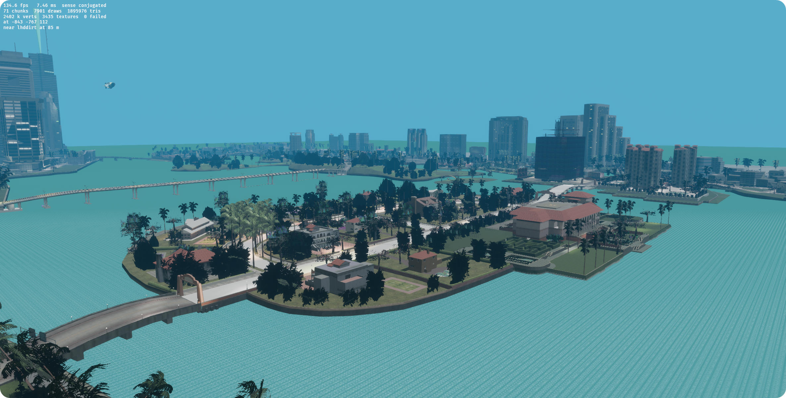

<div align="center">

# vc-rs

**Vice City's assets. A 2026 engine.**

[](../../actions/workflows/ci.yml)
[](LICENSE-MIT)
[](rust-toolchain.toml)
[%20%C2%B7%20Linux%20(Vulkan)-lightgrey?style=flat-square)](#requirements)
[](#status)

[Overview](#overview) · [Features](#features) · [Requirements](#requirements) · [Setup](#setup) · [Controls](#controls) · [Development](#development) · [Status](#status) · [Roadmap](#roadmap)

</div>



## Overview

`vc-rs` opens the Grand Theft Auto: Vice City installation you already own and runs it on a modern
engine: Rust, Bevy and wgpu, on D3D12 or Vulkan. The art, the map and the data files are the
originals — read-only, never modified. Everything around them is new: a merged-chunk renderer with
a 12 km draw distance, a physically placed sun driven by `timecyc`, an animated water shader, and a
modern post-processing stack.

It is not a mod, not a decompilation and not an emulator. No game code is executed.

> [!IMPORTANT]
> `vc-rs` ships **no game assets**. You need your own copy of Vice City. Nothing from your
> installation is ever committed, bundled or redistributed.

> [!NOTE]
> Pre-alpha. The city renders and you can walk and fly through it; vehicles, pedestrians, audio
> and missions are not built yet. See [Status](#status) for exactly what runs today.

## Features

**Rendering**

- **The whole city, resident.** 1.9 M triangles and 7,400 placements baked once into 71 merged
  chunks — nothing pops in at a cell boundary, and the far shore is visible well past the
  original's 2,000-unit fog wall.
- **12 km draw distance.** The camera's far plane is 12,000 units and the sky is drawn beyond the
  city, so the horizon reads as a horizon.
- **Physically placed sun.** Direction, colour and intensity come from `timecyc.dat`; the sun disc
  is drawn where the data puts it.
- **Day-night cycle.** One game hour per real minute; every hour rebuilds the sky row and carries
  the sun, ambient fill, fog distance, water tint and street lighting with it.
- **Animated water.** Two coprime-scale samples of the shipped caustic texture drift against each
  other to make ripples, tinted toward the timecyc's deep colour with a sunset reflection.
- **3,511 authored street lights.** Taken from the map's own `2dfx` data, not invented; the nearest
  96 are live and follow the clock.
- **Post-processing.** SSAO, FXAA, bloom, depth of field and ACES tonemapping, all switchable.
- **Uncapped frame rate.** Nothing is frame-limited: the renderer runs as fast as the GPU allows,
  and the HUD reports what it achieves.

**World and data**

- **Original formats, read directly** — DFF, TXD, COL, IPL, IDE, `timecyc.dat`, `water.dat`,
  `paths.ipl`. No conversion step, no intermediate asset dump.
- **Textures decoded properly** — block-compressed BC1/BC2 with generated mip chains, size-keyed so
  same-named textures from different dictionaries never substitute for each other.
- **Collision** — 3,825 collision models from the 30 shipped `.col` files, with box and triangle
  surfaces available to the ground query.
- **Walking and flying** — a capsule player with gravity, ground snap and wall casts.

## Requirements

| | |
|---|---|
| Game | **Grand Theft Auto: Vice City**, PC 1.0 — `models/gta3.img` must exist |
| OS | Windows 10/11 with a D3D12 GPU (primary); Linux with Vulkan |
| Toolchain | Rust **1.99.1**, pinned by `rust-toolchain.toml` |
| GPU | A modern discrete GPU — the reference run is an RTX 5060 at 1080p |

## Setup

### 1. Get your own copy of the game

Any PC release of Vice City works as long as `models/gta3.img` is present. Install it wherever you
like; `vc-rs` only ever reads from it.

### 2. Install the Rust toolchain

```powershell
winget install Rustlang.Rustup
rustup toolchain install 1.99.1
```

The repository pins the toolchain, so `cargo` will select it automatically inside the project.

### 3. Clone and point at your installation

```powershell
git clone https://github.com/immutex/gta-vc-rust.git
cd gta-vc-rust
```

Then either set an environment variable:

```powershell
$env:VC_GAME_ROOT = "C:\Program Files (x86)\Rockstar Games\Grand Theft Auto Vice City"
```

…or copy (or symlink) the installation into the repository as `gta-vc`:

```powershell
New-Item -ItemType Junction -Path gta-vc -Target "C:\Games\Vice City"
```

`gta-vc/` is git-ignored, so a junction there can never be committed.

### 4. Build and run

```powershell
cargo run --release -p vc_game
```

The first build compiles Bevy and takes several minutes; later runs start in seconds. A window
opens on the waterfront with the whole city loaded.

> [!TIP]
> Release builds are substantially faster than debug builds. Use `--release` for anything you
> intend to look at.

> [!NOTE]
> If the game fails to start with "installation not found", check that `VC_GAME_ROOT` points at the
> folder containing `models/`, `data/` and `Audio/` — not at the `.exe`.

## Controls

| Input | Action |
|---|---|
| `W` `A` `S` `D` | fly, or walk on foot |
| `Space` / `Ctrl` | rise and descend while flying; jump while walking |
| Hold left mouse | look around |
| `Shift` | fly four times faster, or move twice as fast on foot |
| `F` | switch between flying and walking |
| `R` | apply the other rotation sense, for comparison |
| `F12` | write a screenshot next to the executable |

The window reports frame rate, frame time, chunks, draws, triangles, textures, your coordinates and
the nearest model by name.

### Command line

```powershell
cargo run --release -p vc_game -- <cell-x> <cell-y> [hour]
```

Start cells differ a lot — much of the map is shoreline and canal, so several of the busiest cells
open over water. `1 1` is the waterfront; the HUD shows which cell you are in, so you can jump to
anywhere you like. The optional hour opens the day-night cycle at a given time (`21` for street
lights on).

### Environment switches

| Variable | Effect |
|---|---|
| `VC_GAME_ROOT` | path to the installation |
| `VC_AMBIENT` | ambient fill brightness (default `3000`) |
| `VC_TIME_SCALE` | game hours per real second (default `1/60` — one hour per minute) |
| `VC_TIME_PAUSED` | hold the hour still |
| `VC_NO_AA` | switch antialiasing off, for measuring its cost |
| `VC_NO_WATER` | skip the ocean, useful when inspecting geometry |

## Development

Build and test in WSL; run the game on Windows. Keep `target/` on the Linux filesystem, because
building across the Windows mount is several times slower:

```bash
export CARGO_TARGET_DIR="$HOME/.cache/vc-rs/target"
cargo xtask check          # fmt, clippy, tests, licence and duplicate check
./scripts/smoke.sh         # boot the runtime for one frame and fail on a panic
```

The smoke test matters: `cargo xtask check` compiles and tests, but it does not run the app, and
three startup defects have reached players that way.

For a frame without a window — the same scene the game draws, written to a PNG:

```bash
cargo run -p vc_game --example shot -- shot.png 1 1
```

Rules for Rust code, commit messages and game data: see [CONTRIBUTING.md](CONTRIBUTING.md).
Architecture, decisions, milestones and risks: see [PLAN.md](PLAN.md).

### Project layout

| Path | Contents |
|---|---|
| `crates/vc_transport` | installation discovery and read-only archive access |
| `crates/vc_dff`, `vc_txd`, `vc_col`, `vc_ipl`, `vc_ide`, `vc_paths`, `vc_timecyc` | one crate per shipped format |
| `crates/vc_cook`, `vc_world`, `vc_stream`, `vc_physics` | cooking, placements, streaming and collision |
| `crates/vc_render` | materials, chunk batching, the water and sky shaders |
| `crates/vc_game` | the runtime: systems, HUD, scene setup |
| `xtask` | repository automation, invoked as `cargo xtask` |

## Status

Pre-alpha, but the part that matters works: **the city renders, and you can walk and fly through
it at an uncapped frame rate.** The reference machine reports roughly 135 fps at 1080p with the
whole map resident.

| Working today | |
|---|---|
| World | whole map resident, 12 km view, 7,901 merged draws, 1.9 M triangles |
| Lighting | timecyc sun and ambient, SSAO, ACES, bloom, depth of field, FXAA |
| Time | day-night cycle at one game hour per minute; street lights switch on at dusk |
| Water | animated ripple shader with sunset reflection |
| Movement | free camera, and a capsule player with gravity and ground collision |
| Data | 4,131 object definitions, 9,114 placements, 3,825 collision models |

| Not built yet | |
|---|---|
| Vehicles | — |
| Pedestrians and traffic | — |
| Audio | — |
| Missions | out of scope by design |

## Roadmap

| Stage | Goal |
|---|---|
| done | asset reconnaissance, RenderWare readers, collision, the whole city resident |
| **now** | sky dome with clouds; a static smoke test in CI; texture atlasing for the draw count |
| next | vehicles, then traffic and pedestrians driven by the shipped data |
| later | combat, audio, UI and the mission-free sandbox |

## Legal

Unofficial and unaffiliated with Rockstar Games or Take-Two Interactive. "Grand Theft Auto" and
"Vice City" are trademarks of their respective owners. This project contains no game assets and
does not support their redistribution.